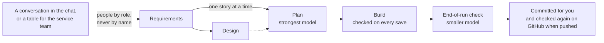

# Build your own service with AI: the Bexley AI build harness workshop

A hands-on workshop for London Borough of Bexley developers. You bring a real project. An AI coding assistant asks you about it in the chat, writes its requirements and designs it, then plans, builds and checks its first piece with you, to the council's brand, accessibility and legal standards. The assistant writes the files and commits the work for you, so you hardly touch the repository yourself. Everything happens in your own service repository, made from the Bexley app template.

There are two tracks with the same exercises: one for **Claude Code** and one for **GitHub Copilot** in VS Code.

> [!NOTE]
> There's no set scenario to build. Use your own project throughout. Examples in the instructions show what an answer could look like; they're never something you have to build.

> [!IMPORTANT]
> This workshop is hosted on `github.com/dbraben` during the pilot, and will move to the council's GitHub. See [Moving to the council's GitHub](#moving-to-the-councils-github).

## Session description

AI coding assistants can build canvas apps, Copilot Studio agents and flows quickly, but quick isn't the same as accessible, lawful and on brand, and it's no use if it isn't what the service needs. The Bexley AI build harness starts from what the people who run the service actually said. It makes the assistant follow the council's standards and check its own work. It plans on the strongest model, builds on the everyday model, and checks on a smaller one before it can finish. Then it commits the work for you, on your computer, and the same checks run again on GitHub when you push it there.

In this workshop you use the harness the way you will on every project: from a conversation about the service, through requirements, a design and a plan, to a first piece of working software, reviewed to zero findings and committed in your repository.

## How the harness works



- **Three repositories, and yours.** The [standards](https://github.com/dbraben/lbbexley-digital-standards) hold the rules, skills and checks. The [app template](https://github.com/dbraben/lbbexley-app-template) is a stamp for new service repositories. This workshop holds the instructions. Your own service repository is where all your work happens, and it follows the standards at a pinned release.
- **Your words in, no personal data.** The assistant asks its questions in the chat, a few at a time, or gives them to you as a table for the service team. People are described by role, never by name. A Teams meeting transcript can help too: it's cleaned on your computer first, with roles instead of names and contact details removed, and the original never goes in a repository or near an assistant.
- **Plan, build, check, commit.** Every change is planned before it's built, checked after every save, and checked again before the assistant can finish. Then the assistant commits it for you, on your computer: no Git commands, branches or pull requests. Zero findings of any severity is done.

[Exercise 01](instructions/01-how-the-harness-works.md) explains it all in more detail.

## Getting started

### In a guided session

The facilitator has set up the repositories, the dev environments and your access. Before the session, do [00 Before you start](instructions/00-before-you-start.md): choose your project, and gather what you know about it. Then follow the [exercises](instructions/README.md) on the day.

### On your own

You need:

- a project of your own, and ideally the people who run the service, to answer questions about it
- a GitHub account, and access to [lbbexley-app-template](https://github.com/dbraben/lbbexley-app-template) and [lbbexley-digital-standards](https://github.com/dbraben/lbbexley-digital-standards)
- Claude Code's command-line version with a Claude Pro or Max subscription, or GitHub Copilot with agent mode in VS Code
- VS Code, Git and Node.js 22 or later
- for building in a dev environment: a Power Platform dev environment with Dataverse and the Bexley publisher, from the Digital Team

Then start with [00 Before you start](instructions/00-before-you-start.md). Without a dev environment you can do everything except some of the build routes in exercise 09.

## Learning outcomes

By the end, you can:

- explain how the harness works: the three repositories, plan, build and check, and the guardrails
- create a service repository for your project, and say how it refers to the Bexley standards and gets new releases
- get requirements from a conversation in the chat, or from a table of questions the service team fills in, with people described by role and no personal data
- check requirements with user stories and checkable acceptance criteria, and design the service
- plan a story with the exact words users will read, and build it with an assistant to zero standards findings
- read and act on the three layers of checks, run the accessibility tests, and test by hand what no tool can
- send an improvement to the harness back to the Digital Team

## What you'll leave with

| Part | Where | Exercises |
|---|---|---|
| Your service repository, set up for your project | On your computer, and in your GitHub account once you push it | 02 to 04 |
| Requirements with user stories, checked with you in the chat, and a summary for the service owner | `docs/requirements.md` | 05 and 06 |
| The design of the service | `docs/architecture.md` | 07 |
| A plan and the first piece of one story, built and tested | `docs/plans/`, `src/` and `tests/` | 08 to 10 |
| Work reviewed to zero findings, committed one piece at a time, and an idea for the harness | Your repository, and the standards repository's issues | 11 and 12 |

## Exercises

| # | Exercise | Claude Code | GitHub Copilot |
|---|---|---|---|
| 00 | Before you start | [Both tracks](instructions/00-before-you-start.md) | |
| 01 | How the harness works | [Both tracks](instructions/01-how-the-harness-works.md) | |
| 02 | Create your service repository | [Both tracks](instructions/02-create-your-service-repo.md) | |
| 03 | Turn on the standards | [Claude Code](instructions/claude-code/03-turn-on-the-standards.md) | [Copilot](instructions/github-copilot/03-turn-on-the-standards.md) |
| 04 | Set up your service | [Claude Code](instructions/claude-code/04-set-up-your-service.md) | [Copilot](instructions/github-copilot/04-set-up-your-service.md) |
| 05 | Answer the requirements questions | [Both tracks](instructions/05-answer-the-requirements-questions.md) | |
| 06 | Check the requirements | [Claude Code](instructions/claude-code/06-check-the-requirements.md) | [Copilot](instructions/github-copilot/06-check-the-requirements.md) |
| 07 | Design the service | [Claude Code](instructions/claude-code/07-design-the-service.md) | [Copilot](instructions/github-copilot/07-design-the-service.md) |
| 08 | Plan the first story | [Claude Code](instructions/claude-code/08-plan-the-first-story.md) | [Copilot](instructions/github-copilot/08-plan-the-first-story.md) |
| 09 | Build it | [Claude Code](instructions/claude-code/09-build-it.md) | [Copilot](instructions/github-copilot/09-build-it.md) |
| 10 | Check and test | [Claude Code](instructions/claude-code/10-check-and-test.md) | [Copilot](instructions/github-copilot/10-check-and-test.md) |
| 11 | Review your work | [Claude Code](instructions/claude-code/11-review-your-work.md) | [Copilot](instructions/github-copilot/11-review-your-work.md) |
| 12 | Improve the harness | [Claude Code](instructions/claude-code/12-improve-the-harness.md) | [Copilot](instructions/github-copilot/12-improve-the-harness.md) |
| 13 | Wrap-up and next steps | [Both tracks](instructions/13-wrap-up.md) | |

Optional, before exercise 05, for anyone who has recorded a Teams meeting with the service team: [Use a Teams meeting transcript](instructions/use-a-teams-transcript.md).

## What's in this repository

| Folder | What it holds |
|---|---|
| [instructions/](instructions/) | The exercises: shared ones at the top level, then [claude-code/](instructions/claude-code/) and [github-copilot/](instructions/github-copilot/) |
| [delivery-resources/](delivery-resources/) | The facilitator guide: preparation, running orders, talking points and common problems |

There's nothing to copy or run from this repository: everything you build, and every tool you use, is in your own service repository.

## Using this workshop

- **Attendees** read the instructions here. Your own work happens in your own service repository, made from the template in exercise 02. You don't fork or change this repository.
- **Facilitators** follow the [facilitator guide](delivery-resources/README.md). It says what to set up beforehand, what to ask attendees to prepare, and which exercises fit a shorter session.
- **Version.** These instructions match the Bexley AI build harness **v0.5.0**. If the template or the standards are on a newer release, check the changes in the standards repository's CHANGELOG before running the workshop.

## Changing this workshop

Anyone in the Digital Team can change the exercises or the guide. [CONTRIBUTING.md](CONTRIBUTING.md) says how, including keeping the two tracks in step, writing examples that never become a set scenario, and updating the workshop when the harness has a new release.

To change the harness itself (the skills, checks, transcript cleaner and template), don't edit it here: use the improve loop in exercise 12, or the standards repository's CONTRIBUTING.md.

## Moving to the council's GitHub

When the repositories move from `github.com/dbraben` to the council's GitHub organisation:

1. Transfer this repository, `lbbexley-digital-standards` and `lbbexley-app-template` to the organisation (each repository's **Settings**, then **Transfer ownership**). GitHub redirects the old addresses for a while, but update every reference anyway.
2. In all three repositories, replace `dbraben` with the organisation's name. This finds every place, including the template's `.claude/settings.json` and workflows, the standards' `config/standards.json` and reusable workflow, and every CODEOWNERS file:

   ```bash
   git grep -n dbraben
   ```

3. Release the standards with the new references, then update the template to that release (`npm run standards:update -- <version>`) and update this workshop's version references.
4. Run through exercises 00 to 04 on both tracks to check the links and the set-up still work.

## Continue your learning

- The standards repository's onboarding guide, [docs/onboarding.md](https://github.com/dbraben/lbbexley-digital-standards/blob/main/docs/onboarding.md), for setting up a real service
- [Start, stop and download live transcripts in Microsoft Teams meetings](https://support.microsoft.com/teams/meetings/start-stop-and-download-live-transcripts-in-microsoft-teams-meetings) (Microsoft Support)
- [Create canvas apps with external tools](https://learn.microsoft.com/en-us/power-apps/maker/canvas-apps/create-canvas-external-tools) (Microsoft Learn)
- [Clone your Copilot Studio agent in Visual Studio Code](https://learn.microsoft.com/en-us/microsoft-copilot-studio/visual-studio-code-extension-clone-agent) (Microsoft Learn)

## Content owner

The London Borough of Bexley Digital Team. Maintained by dbraben until the repositories move to the council's GitHub.

## Deliver this session

Facilitators: start with the [facilitator guide](delivery-resources/README.md).
