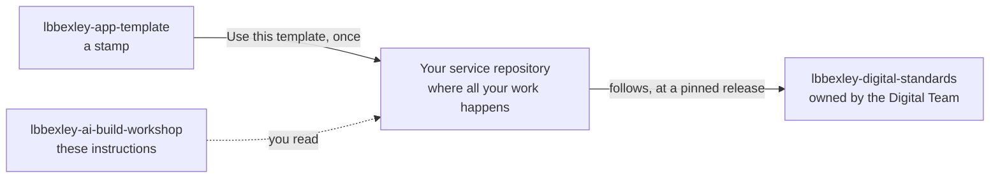
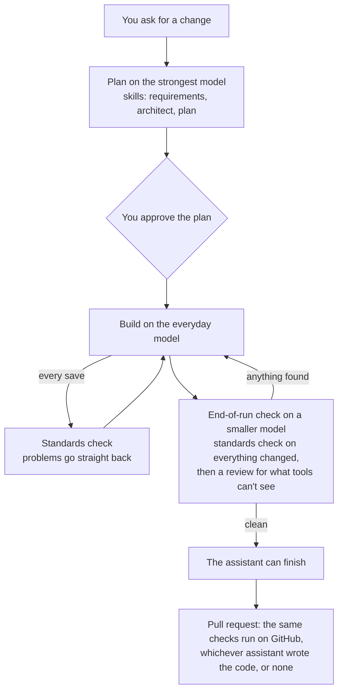
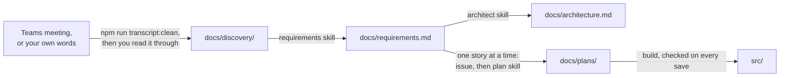

# 01 How the harness works

*About 15 minutes · Both tracks · Reading, then a short look around*

Before you use the harness on your project, it helps to know what it is, where things live, and what happens when you ask the assistant to do something. Nothing here is specific to one assistant: both tracks work the same way underneath.

## What it's for

An AI coding assistant can build a canvas app screen, a flow or a Copilot Studio topic in minutes. Quick isn't the same as accessible, lawful and on brand. The harness gives the assistant the council's standards as instructions it follows, and makes it check its own work at every step, so what it builds meets the same bar as the work of the council's best developers.

## Three repositories, and yours

| Repository | What it is | What you do with it |
|---|---|---|
| **Your service repository** | Your project: its requirements, design, plans, source, tests and compliance documents | Everything. You create it in exercise 02 |
| **lbbexley-app-template** | A stamp for new service repositories | Select **Use this template**, once. You never change it |
| **lbbexley-digital-standards** | The standards themselves: skills, guardrails, the standards check and the pull request check | Nothing directly. Your repository follows it, and you can propose changes (exercise 12) |
| **lbbexley-ai-build-workshop** | These instructions | Read them |

Every reference points one way: from your repository to the standards. The standards never need to know your project exists, and a new release never changes your checks until you choose to update, in a pull request of your own.

## What happens when you ask the assistant for something

1. **Plan, on the strongest model.** The assistant writes down what it will do before it does it: the user need, the exact words people will read, and acceptance criteria someone can check. Nothing changes until you approve.
2. **Build, on the everyday model.** Each time the assistant saves a file, the standards check runs and sends every problem straight back to it, so it fixes them while the file is still open.
3. **Check, on a smaller model.** Before the assistant can finish, the end-of-run check runs the standards check on everything it changed, and a reviewer looks for what rules can't catch, such as unclear wording or a missing test. It also notes ideas for improving the harness.
4. **Pull request.** GitHub runs the Bexley standards check again on every pull request. It doesn't depend on any assistant, so it's the backstop.

Along the way, guardrails stop the assistant doing things it shouldn't: deploying to test or production, deleting Dataverse records, or (in Claude Code) receiving a prompt with real-looking personal data in it.

## How each assistant gets the standards

| | Claude Code | GitHub Copilot |
|---|---|---|
| Skills (brand, accessibility, content style, the legal duties, one per platform, and requirements, architect, plan, review, improve) | The **lbbexley** plugin, installed from the standards repository | Copies in `.github/skills/lbbexley-*` |
| Plan, build and check | Plan mode with `opusplan`: Opus plans, Sonnet builds, Haiku reviews | The **lbbexley-plan**, **lbbexley-build** and **lbbexley-check** agents, which hand over to each other |
| Standards check after each save, and the end-of-run check | Plugin hooks | Copilot hooks (a preview feature) in `.github/hooks/lbbexley.json` |
| Rules for particular files | `.claude/rules/lbbexley-*` | `.github/instructions/lbbexley-*` |

The copies are synced from the standards repository at the release your repository is on, so both assistants follow identical rules.

## Where things live in your repository

| Where | What | Who changes it |
|---|---|---|
| `AGENTS.md` (and `CLAUDE.md`) | Your service's details and the rules that always apply. Both assistants read it first | You, through the set-up in exercise 04 |
| `docs/discovery/` | Cleaned meeting transcripts, notes and your requirement prompt | You. Git ignores everything here except the README, but approved AI tools may still read and process its contents, so only cleaned material goes in |
| `docs/requirements.md` | Users, user stories with acceptance criteria, rules, data, duties and open questions | The requirements skill, checked by the service owner |
| `docs/architecture.md` | The design: components, data flow, duties, diagram | The architect skill |
| `docs/plans/` | One plan per change | The plan skill |
| `src/` | The source: canvas apps, Power Pages, agents, flows, Dataverse | The assistant, and you |
| `tests/` | What the accessibility tests open, the agent test set, and your manual test log | You and the assistant |
| `docs/compliance/` | Accessibility statement, DPIA screening, equality impact, publicity check, ATRS record, retention | You and the service team |
| `.github/skills/lbbexley-*`, `.github/agents/lbbexley-*`, `.lbbexley/standards/` and the other synced files | Copies of the standards | Nobody by hand. `npm run standards:update` replaces them |

## From a conversation to working software

That's the path you'll follow in exercises 05 to 11, with your own project.

## Look around

Open [lbbexley-app-template](https://github.com/dbraben/lbbexley-app-template) on GitHub and find:

1. `AGENTS.md`: the **Never** list. Which commands can't the assistant run?
2. `.github/workflows/quality.yml`: the line with `uses:`. Which release of the standards does the pull request check use?
3. `docs/discovery/.gitignore`: why does it contain a single `*`?
4. `.claude/settings.json`: the `deny` list. Which file types can't Claude Code read?
5. `.github/skills/`: is there a skill for each platform you might use in your project?

## Check

- [ ] You can say what each of the three repositories is for, and which one you'll work in
- [ ] You can name the three steps every change goes through, and the model each runs on
- [ ] You know that `docs/discovery/` never leaves your computer, and why
- [ ] You found the answers to the five questions above

---

[← 00 Before you start](00-before-you-start.md) · [Next: 02 Create your service repository →](02-create-your-service-repo.md)
